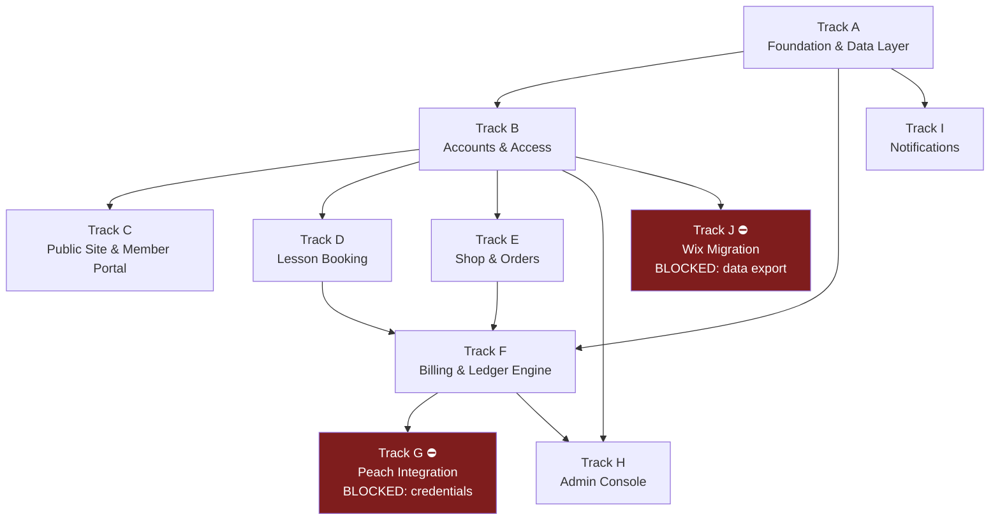
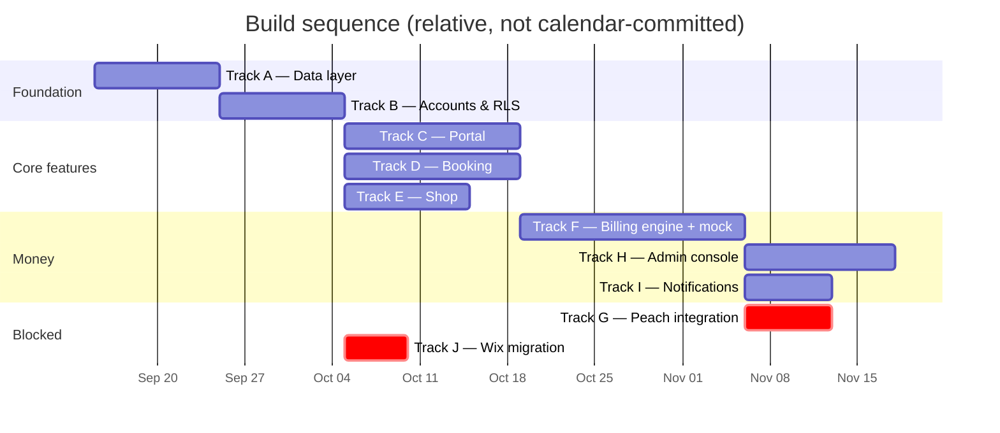

# CFA Platform — Project Specification & Build Plan

**Project:** Cape Fencing Academy member, booking and billing platform
**Team:** Leo (lead), Ameer, Jack, Reabetswe
**Sponsor:** Jeremy Saner (CFA)
**Stack:** Next.js · TypeScript · Supabase (Postgres + RLS) · shadcn/ui · Tailwind · Vercel
**Companion doc:** `CFA_Payments_Technical_Spec.md` (payment internals, schema, diagrams)

---

## 0. The short version

We are **not blocked**. Roughly 80% of the platform can be built right now without a single answer from Jeremy.

The one thing that makes this possible is a decision in Track F: **we build against a payment provider *interface*, not against Peach directly.** A mock provider lets us build and fully test the entire billing engine — invoices, allocations, webhooks, retries, out-of-order events, refunds — before Peach credentials ever arrive. When the credentials land, we swap one implementation file and the rest of the system does not change.

Everything we can't confirm becomes either a **config value with a marked placeholder** or a **feature flag that is off**. Nothing gets hardcoded to a guess.

---

## 1. Confirmed scope

From the agreed scope update, v1 is three things:

1. **Rebuild the site** (member-facing).
2. **Add members and track their expenses** (members rent equipment, book lessons, etc.).
3. **Automate sending invoices with a payment link attached.**

Everything in this document serves those three. Anything outside them is explicitly v2.

---

## 2. What is already settled

These are fixed. Do not re-open them without Leo explicitly revisiting.

**Accounts**
- Four account types: adult member, parent/guardian, child/dependent, drop-in non-member.
- Public visitors can self-register and book lessons. Becoming a *paying member* is staff-gated.
- Guardians are billing-responsible for their dependents.
- Dependents have their own login, see their own lesson history, can self-book, and **never see financial information** — enforced server-side via RLS, not by hiding UI.
- Guardians can book on their dependents' behalf.

**Lessons**
- One-on-one, 30-minute sessions.
- Coaches set **standing weekly schedules with exceptions**, not weekly uploads.
- First-come-first-served with instant confirmation.
- Double lessons (max two fencers, double price, booked as a single unit) are a real v1 feature.

**Billing**
- Monthly invoices run on the **25th**.
- Lessons: pay-now **or** defer to the monthly invoice.
- **Shop and equipment orders are pay-now, always.** Never deferred to an invoice, because CFA needs the cash to fund the next stock shipment. A shop order produces a receipt, not an invoice line.
- 6-month membership prepay exists, at a 10% discount.
- Peach Payments is the provider.

**Engineering**
- Extend the existing codebase. The guardian-dependent account model and the billing ledger already exist — new work extends them rather than building parallel systems.
- The public site's **hero section and top navigation already exist and must not be rebuilt**.
- Coding agents receive behaviour specs and definitions of done, not architecture.

**Explicitly forbidden until Jeremy confirms**
- **Junior / Senior / Social class categories must not appear anywhere in the system** — not in the database, not in seed data, not in the UI, not in a dropdown. These are unconfirmed.

---

## 3. The placeholder strategy

Every unconfirmed value lives in **one file**, never scattered through the code:

```ts
// config/pending-decisions.ts
//
// ⚠️  EVERY VALUE HERE IS A PLACEHOLDER AWAITING JEREMY'S CONFIRMATION.
//     Do not treat any of these as correct. Do not copy them elsewhere.
//     Each entry maps to an ID in the Pending Decisions Register (§6).

export const PENDING = {
  // [J-01] VAT registration status unknown
  VAT_ENABLED: false,
  VAT_RATE: 0.15,                        // SA standard rate, applied only if VAT_ENABLED

  // [J-02] Cancellation & no-show policy undefined
  FREE_CANCELLATION_HOURS: 24,           // PLACEHOLDER
  NO_SHOW_FEE_PERCENT: 100,              // PLACEHOLDER
  LATE_CANCEL_FEE_PERCENT: 50,           // PLACEHOLDER

  // [J-03] Pricing not confirmed
  LESSON_PRICE_CENTS: 25000,             // PLACEHOLDER R250
  DOUBLE_LESSON_PRICE_CENTS: 50000,      // PLACEHOLDER R500
  MONTHLY_MEMBERSHIP_CENTS: 45000,       // PLACEHOLDER R450
  PREPAY_6M_DISCOUNT_PERCENT: 10,        // CONFIRMED

  // [J-04] Arrears rules undefined
  BLOCK_BOOKING_ON_ARREARS: false,       // PLACEHOLDER — off until confirmed
  ARREARS_THRESHOLD_DAYS: 30,            // PLACEHOLDER

  // [J-05] Notification channels undecided
  NOTIFY_EMAIL: true,
  NOTIFY_WHATSAPP: false,                // off until confirmed

  // [J-06] Refund policy undefined
  DEFAULT_REFUND_METHOD: 'account_credit' as const,
  REFUND_REQUIRES_OWNER_APPROVAL_ABOVE_CENTS: 100000, // PLACEHOLDER R1000
} as const
```

**Rules for the team:**

1. A placeholder value appears **exactly once**, in this file. Never inline a guessed number.
2. Any UI showing a placeholder-derived figure renders a small **"provisional"** badge in non-production builds, so nobody demos a fake price to Jeremy thinking it's real.
3. Features gated on an unknown decision ship **off by default**.
4. When Jeremy answers, we change one line here and delete the comment. That is the whole migration.

---

## 4. Build tracks — what we do NOW

Nine tracks. Seven are fully unblocked; two are parked.



---

### Track A — Foundation & data layer
**Status: fully unblocked. Start immediately.**

Extend the existing schema to the target state in the technical spec.

- Enums, money as `bigint` cents throughout (never floats).
- `profiles`, `guardianships`, `memberships`.
- `invoices`, `invoice_line_items`.
- `payments`, `payment_allocations`, `webhook_events`, `saved_cards`, `refunds`, `account_credits`.
- `products`, `orders`, `order_items`, `lesson_bookings`.
- `notifications`, `audit_log`.
- The `recalculate_invoice_status()` function as the single source of truth for paid/outstanding.
- Migrations are forward-only and reviewed before merge.
- Seed script with realistic fake members, coaches, lessons and orders.

**Note:** the schema itself is not blocked by Jeremy. His open items affect *values and rules*, not table structure. The one exception is equipment rental (J-07), which stays unmodelled for now.

**Done when:** migrations run clean on a fresh database, seed data loads, and the ledger function passes unit tests for full, partial, over- and split payments.

---

### Track B — Accounts & access control
**Status: fully unblocked.**

- Supabase Auth wiring, self-registration, email verification, password reset.
- The four account types.
- Guardian ↔ dependent linking, with a guardian invite flow for dependents.
- Staff gating: only staff can promote a registered visitor to paying member.
- **RLS policies**, especially the rule that dependents can read no financial rows at all. This is enforced at the database, and we write tests that log in as a dependent and assert zero rows returned from `invoices` and `payments`.
- Staff/admin role flag and an `is_staff()` helper.

**Done when:** an automated test suite proves each account type sees exactly what it should and nothing more.

---

### Track C — Public site & member portal
**Status: fully unblocked.**

- Rebuild member-facing pages. **Do not touch the existing hero or top navigation.**
- Member dashboard: upcoming lessons, lesson history, account balance, invoices.
- Guardian dashboard: same, plus a per-dependent view.
- Dependent dashboard: lessons only, **no money anywhere**.
- Profile and contact management.
- "Manage saved cards" screen — builds fine against the mock provider.

**Done when:** all three dashboards work end-to-end against seeded data, responsive on mobile.

---

### Track D — Lesson booking engine
**Status: unblocked. Policy *values* are placeholders; the mechanism is fully specifiable.**

- Coach standing weekly schedules plus exceptions (holidays, one-off changes).
- Slot generation and availability.
- First-come-first-served booking with instant confirmation and a race-condition guard (two members must never win the same slot — use a database constraint, not application checks).
- Double-lesson booking as a unit.
- Cancel and reschedule, driven by `PENDING.FREE_CANCELLATION_HOURS`.
- Coach attendance marking → feeds no-show fees.
- Admin override for any booking.
- Pay-now vs pay-later choice at booking, writing `lesson_bookings.pay_now`.

**Placeholder dependency:** cancellation window and fee percentages (J-02). Build the rules engine to read from config; the numbers change later without touching logic.

**Done when:** a member can book, cancel and reschedule; a coach can mark attendance; a no-show generates a correctly-priced charge using config values.

---

### Track E — Shop & orders
**Status: fully unblocked — the pay-now rule is confirmed.**

- Product catalogue with admin CRUD.
- Cart and checkout.
- Order creation with **stock reservation** and a 30-minute expiry that releases stock (matches Peach's checkout session length).
- Price snapshot on `order_items` so historical orders don't change when prices do.
- Order status flow: `pending_payment → paid → preparing → ready → collected`.
- Receipt generation.
- **Hard rule enforced server-side: an order can never be attached to an invoice.** Write a test that asserts this.

**Done when:** a member can order equipment, the order sits unpaid, the mock payment marks it paid, stock decrements, and an abandoned checkout releases the stock.

---

### Track F — Billing & ledger engine ⭐
**Status: fully unblocked. This is the highest-value track and the one that de-risks everything else.**

This is where the provider abstraction lives.

```ts
// lib/payments/provider.ts
export interface PaymentProvider {
  createCheckout(input: CreateCheckoutInput): Promise<{ checkoutId: string; redirectUrl: string }>
  createPaymentLink(input: CreateLinkInput): Promise<{ url: string; reference: string }>
  chargeToken(input: ChargeTokenInput): Promise<ChargeResult>
  refund(input: RefundInput): Promise<RefundResult>
  getStatus(reference: string): Promise<ProviderStatus>
  verifyWebhook(req: Request): Promise<WebhookEvent | null>
}
```

Two implementations:

- `MockProvider` — a local fake checkout page that lets us trigger **success, decline, pending, cancelled, uncertain, late-success, duplicate webhook and out-of-order webhook** on demand.
- `PeachProvider` — written in Track G, drops into the same interface.

Build against the interface:

- Invoice generation from unbilled lessons, fees and membership dues.
- The **25th-of-the-month scheduled job** (Vercel Cron hitting a protected API route).
- Prepaid-membership skip logic — members with an active 6-month prepay are excluded from the monthly run. **Write a test for this specifically; it is the classic bug in prepay systems.**
- Payment attempt creation *before* checkout creation, using our own reference as the provider's transaction ID.
- Allocation of payments to invoices and orders, including partial and split payments.
- The idempotent webhook handler with the unique-index guard and timestamp-based out-of-order protection.
- Refund and account-credit flows.
- Invoice PDF generation, with the VAT line controlled by `PENDING.VAT_ENABLED`.

**Done when:** the full lifecycle — invoice raised, link sent, paid, allocated, partially refunded, credited — runs end to end against `MockProvider`, and the webhook handler survives a replayed and out-of-order event storm without corrupting a single balance.

---

### Track G — Peach Payments integration ⛔
**Status: BLOCKED on Jeremy. Everything else proceeds regardless.**

Needs: sandbox credentials (`entityId` + secret), dashboard access, and confirmation of which features are enabled on CFA's account.

When credentials arrive, this track is small because Track F did the hard part:

- Implement `PeachProvider` against the existing interface.
- Request signing (HMAC-SHA256), server-side only.
- Hosted Checkout initiate + redirect.
- Payment Links for the monthly run.
- Webhook endpoint with IP allowlisting and status re-verification.
- Card tokenisation and saved cards.
- Apple Pay domain verification.
- Refund API.
- Full sandbox test pass before any live credential exists anywhere.

**Interim placeholder:** `MockProvider` is wired in via `PAYMENT_PROVIDER=mock`. Switching to Peach is one environment variable plus one implementation file.

**Estimated effort once unblocked:** small, precisely because it's a swap and not a rewrite.

---

### Track H — Admin console
**Status: mostly unblocked.**

- Member list, search, promote-to-member, deactivate.
- Invoice list with status filters, manual invoice creation, void.
- Payment list, including a **manual payment capture** for cash or off-system payments.
- Refund queue: requested → approve/reject with a note → processed.
- Coach schedule management.
- Product and stock management.
- Audit log viewer.

**Parked sub-feature:** the bank-statement reconciliation screen (EFT matching). Deliberately deferred — see §7.

**Done when:** Jeremy could run a full billing month from the admin console using mock payments.

---

### Track I — Notifications
**Status: unblocked for the engine; channel selection is a placeholder.**

- Template system: invoice issued, payment received, payment failed, booking confirmed, booking cancelled, refund processed.
- Queue with retry, writing to the `notifications` table.
- Email adapter built now.
- WhatsApp adapter behind `PENDING.NOTIFY_WHATSAPP`, off until Jeremy chooses.

**Done when:** every billing and booking event produces the right queued notification, verifiable in the database without actually sending.

---

### Track J — Wix migration ⛔
**Status: BLOCKED on a real data export from Jeremy.**

Known risks already identified:

- Member login credentials **cannot** migrate. Every member must re-register. This needs a communications plan from Jeremy.
- Guardian-to-dependent relationships are not stored in Wix's flat contact model and must be reconstructed manually.
- Pricing Plans subscription data is unreliable in Wix exports.

**Do not write migration scripts against assumptions.** Get a real sample export first, then write the mapping. Until then this track is one task: "request and inspect sample export."

---

## 5. Sequencing



Tracks C, D and E run in parallel across the team once B lands. Track F is the critical path to a demo.

---

## 6. Pending Decisions Register

Everything we need from Jeremy. Each has an ID referenced in `config/pending-decisions.ts`.

### 6.1 Blocking — needed to finish a track

| ID | What we need | Blocks | Our placeholder meanwhile |
|---|---|---|---|
| **J-A** | Peach **sandbox** credentials (`entityId` + secret) | Track G entirely | `MockProvider` |
| **J-B** | Peach **dashboard access** (to set webhook URLs, allowlist our domain) | Track G | — |
| **J-C** | Confirmation of which Peach features are enabled: Payment Links, tokenisation, recurring, wallets, Pay by Bank | Track G scope | Assume all available; verify before building each |
| **J-D** | Real **Wix data export** sample | Track J entirely | No scripts written |
| **J-E** | Peach **live** credentials | Go-live only | Not needed until deployment |

### 6.2 Non-blocking — we build around these

| ID | Question | Affects | Interim placeholder |
|---|---|---|---|
| **J-01** | Is CFA VAT registered? | Invoice layout, PDF, totals | `VAT_ENABLED = false` |
| **J-02** | Cancellation & no-show policy — window and fees? | Booking rules, fee generation | 24h free window, 100% no-show, 50% late-cancel |
| **J-03** | Actual prices: lesson, double lesson, monthly membership | Everything money-facing | Placeholder rands, badged "provisional" |
| **J-04** | Arrears rules — block bookings when unpaid? After how long? | Booking gate | Blocking **off** |
| **J-05** | Notification channels — email, WhatsApp, or both? | Track I | Email on, WhatsApp off |
| **J-06** | Refund policy — what's refundable, within what window, what cancellation charge is reasonable? | Refund flow | Default to account credit; staff approval required |
| **J-07** | Equipment rental — deposit, per-period charge, or on invoice? | Rental module | **Unmodelled.** No tables, no UI. |
| **J-08** | Can separated parents share a dependent? | `guardianships` cardinality | Table is already many-to-many, so structurally safe either way |
| **J-09** | Membership tiers beyond guest access — what does membership unlock? | Access rules | No tiers implemented |
| **J-10** | Junior / Senior / Social categories — real or not? | Class model | **Must not appear anywhere.** Hard rule. |
| **J-11** | Who may approve refunds, and is there a rand limit above which only Jeremy can? | Admin permissions | Any staff; R1000 escalation placeholder |
| **J-12** | Which bank does CFA use, and can it export statement CSVs? | Deferred EFT work | Not needed yet |
| **J-13** | Physical card terminal at the club — wanted or not? | Possible separate hardware purchase | Out of scope for now |

---

## 7. Deliberately deferred

**Manual EFT reconciliation.** We have a designed solution (short typable references, statement import, auto-matching with an exceptions queue) documented in the technical spec, but it is **parked** by decision. Rationale: Peach's Pay by Bank option is likely to convert most EFT users anyway, which shrinks the problem before we spend effort on it. Revisit after the Peach integration is live.

**Recurring auto-charged membership.** Deferred to v2. Automated invoice + payment link solves the actual pain — CFA not knowing who paid — without the approval overhead and consumer-law obligations of auto-charging. Revisit once Peach confirms recurring is activated.

**Automatic bank feeds / open banking.** Noted as a possibility, almost certainly unnecessary at this club's size.

---

## 8. Working agreements

- **Extend, don't rebuild.** The guardian-dependent model and billing ledger exist. New work extends them.
- **Don't rebuild the hero or top nav.**
- **Assumptions are explicit, never blocking.** If Jeremy hasn't answered, pick a sensible default, put it in `pending-decisions.ts`, flag it, and keep moving.
- **Coding agents get behaviour specs and a definition of done**, not architecture or schemas.
- **ClickUp is the authoritative record** of technical decisions. WhatsApp is for coordination only — if a decision happens on WhatsApp, it gets written into ClickUp the same day.
- **Nothing ships to `main` without the RLS tests passing.**

---

## 9. Definition of "v1 demo-ready"

We can demo to Jeremy when, using mock payments:

- [ ] A visitor self-registers and books a lesson.
- [ ] A guardian registers, links a dependent, and books on their behalf.
- [ ] A dependent logs in, sees their lessons, and can reach **no** financial information.
- [ ] A member orders equipment and pays immediately; stock decrements.
- [ ] A coach marks attendance and a no-show generates a fee.
- [ ] The 25th job runs, generates invoices with correct line items, and issues payment links.
- [ ] A member pays a link; the invoice moves to paid automatically, with no human matching.
- [ ] A member with a 6-month prepay is correctly **skipped** by the monthly run.
- [ ] A refund is requested, approved by staff, and issued as an account credit applied to the next invoice.
- [ ] Every one of the above appears correctly in the admin console and the audit log.

None of that needs Jeremy. All of it becomes real by swapping one provider.

---

## 10. Risks

| Risk | Impact | Mitigation |
|---|---|---|
| Jeremy's answers arrive late | Placeholder values ship to production | Provisional badges in non-prod; a pre-go-live checklist that fails if any `PENDING` value is unchanged |
| Peach credentials delayed past demo | Can't show real payments | `MockProvider` demo is fully convincing; frame it as "payments simulated" |
| Wix export worse than expected | Migration blows out | Get the sample export early; treat migration as its own mini-project |
| Members can't re-register after migration | Real member churn | Jeremy needs a communications plan — raise it now, not at cutover |
| Scope creep from unconfirmed features | Team builds the wrong thing | The J-10 rule: unconfirmed concepts do not enter the codebase at all |
| Team builds parallel systems | Duplicate ledgers | "Extend, don't rebuild" enforced at code review |
