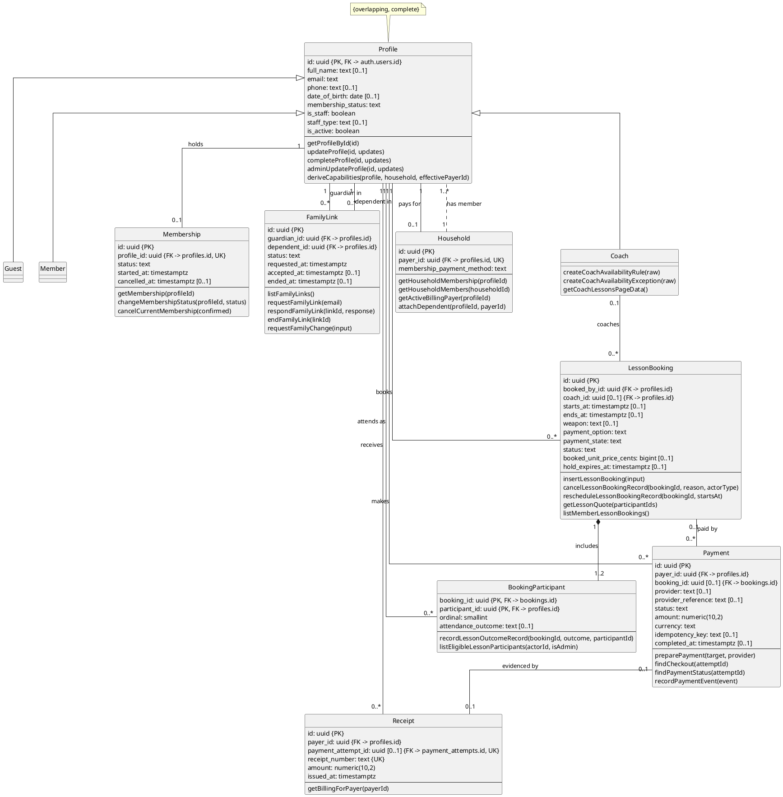

# CFA Platform - Class Diagram Brief (Milestone 3)

This file describes the UML class diagram for the Expanded Class Diagram section of the INF3003W Milestone 3 report. It is generated from `docs/m3/erd/erd_spec.py`, the same source as the ERD and the data dictionary, so the three documents stay consistent.

## Your task

Draw one UML class diagram (draw.io preferred, PlantUML acceptable) that follows these rules:

1. Use **exactly** the classes, attributes, operations, generalisation and associations listed below. Do not add, rename or drop any class, attribute or association.
2. Use the attribute names **exactly as written** (snake_case, matching the database and ERD). Format them as `name: type`, with `[0..1]` for optional values and `{PK}`, `{FK -> table.column}` or `{UK}` as constraints.
3. Put a compartment of operations in each class, using the method names given. Operations take the parameter names shown; leave out return types unless you are sure of them.
4. Show Guest, Member and Coach as subclasses of Profile, using a UML generalisation (hollow triangle arrow pointing to Profile) with the constraint `{overlapping, complete}`.
5. Draw every association in the table below with its multiplicity at **both** ends and its name in the middle. Associations are plain lines (no diamonds) except where aggregation or composition is stated.
6. Do **not** draw foreign-key columns as separate associations. Each association below already represents one foreign key.
7. Layout: Profile at the top centre with its three subclasses directly beneath it. Put Family Link and Household on the left, Membership under Member, Lesson Booking under Coach with Booking Participant beneath it, and Payment and Receipt on the right. Keep lines orthogonal and don't let any line cross a class box.
8. Colour groups (optional, but they match the ERD): people in blue #2F4B8C, family/household in green #2E7D5B, lessons in orange #B35A1F, payments in purple #6A2C91.
9. Make it readable when printed on a landscape A4/Letter page. Use at least 11 pt text, and don't let the diagram become tiny.

## Classes

### Profile  (table `profiles`)

_One record per CFA account. Guests, members and coaches are all stored here and told apart by membership_status and staff fields._

Attributes:

- `id: uuid {PK, FK -> auth.users.id}`
- `full_name: text [0..1]`
- `email: text`
- `phone: text [0..1]`
- `date_of_birth: date [0..1]`
- `membership_status: text`
- `is_staff: boolean`
- `staff_type: text [0..1]`
- `is_active: boolean`

Operations (source):

- `getProfileById(id)` - lib/repositories/MemberRepository.ts
- `updateProfile(id, updates)` - lib/repositories/MemberRepository.ts
- `completeProfile(id, updates)` - lib/repositories/MemberRepository.ts
- `adminUpdateProfile(id, updates)` - lib/repositories/MemberRepository.ts
- `deriveCapabilities(profile, household, effectivePayerId)` - lib/services/MemberService.ts

### Guest  (subclass of Profile, no own table)

_Someone with an account who is not (yet) a club member. Can book and pay for lessons._ Identified by `membership_status = 'guest'` in `profiles`.

Attributes: none of its own (inherits all Profile attributes).

Operations: none of its own (inherits Profile operations). Leave the operations compartment empty.

### Member  (subclass of Profile, no own table)

_A profile whose membership_status is 'member'. It is set when an application is approved and returns to guest when an administrator ends the membership, so the Membership record itself is linked to Profile._ Identified by `membership_status = 'member'` in `profiles`.

Attributes: none of its own (inherits all Profile attributes).

Operations: none of its own (inherits Profile operations). Leave the operations compartment empty.

### Coach  (subclass of Profile, no own table)

_A staff coach who gives lessons. A coach can also be a member._ Identified by `is_staff AND staff_type = 'coach'` in `profiles`.

Attributes: none of its own (inherits all Profile attributes).

Operations (source):

- `createCoachAvailabilityRule(raw)` - lib/services/LessonBookingService.ts
- `createCoachAvailabilityException(raw)` - lib/services/LessonBookingService.ts
- `getCoachLessonsPageData()` - lib/services/LessonBookingService.ts

Generalisation note: Overlapping: a coach may also be a guest or a member. Guest and Member are mutually exclusive. Show this with `{overlapping, complete}` on the generalisation.

### Membership  (table `memberships`)

_The club membership held by a member, with its lifecycle state._

Attributes:

- `id: uuid {PK}`
- `profile_id: uuid {FK -> profiles.id, UK}`
- `status: text`
- `started_at: timestamptz`
- `cancelled_at: timestamptz [0..1]`

Operations (source):

- `getMembership(profileId)` - lib/repositories/PlatformRepository.ts
- `changeMembershipStatus(profileId, status)` - lib/repositories/PlatformRepository.ts
- `cancelCurrentMembership(confirmed)` - lib/services/PlatformService.ts

### FamilyLink  (table `family_links`)

_A guardian-dependent relationship between two existing accounts, from invitation to end._

Attributes:

- `id: uuid {PK}`
- `guardian_id: uuid {FK -> profiles.id}`
- `dependent_id: uuid {FK -> profiles.id}`
- `status: text`
- `requested_at: timestamptz`
- `accepted_at: timestamptz [0..1]`
- `ended_at: timestamptz [0..1]`

Operations (source):

- `listFamilyLinks()` - lib/repositories/PlatformRepository.ts
- `requestFamilyLink(email)` - lib/repositories/PlatformRepository.ts
- `respondFamilyLink(linkId, response)` - lib/repositories/PlatformRepository.ts
- `endFamilyLink(linkId)` - lib/repositories/PlatformRepository.ts
- `requestFamilyChange(input)` - lib/repositories/FamilyRepository.ts

### Household  (table `households`)

_A billing unit with exactly one payer. A trigger gives every new account its own household; billing between linked family accounts is resolved through family links._

Attributes:

- `id: uuid {PK}`
- `payer_id: uuid {FK -> profiles.id, UK}`
- `membership_payment_method: text`

Operations (source):

- `getHouseholdMembership(profileId)` - lib/repositories/MemberRepository.ts
- `getHouseholdMembers(householdId)` - lib/repositories/MemberRepository.ts
- `getActiveBillingPayer(profileId)` - lib/repositories/MemberRepository.ts
- `attachDependent(profileId, payerId)` - lib/repositories/MemberRepository.ts

### LessonBooking  (table `bookings`)

_A private lesson with a coach at a set time, including the payment choice and the price captured when it was booked._

Attributes:

- `id: uuid {PK}`
- `booked_by_id: uuid {FK -> profiles.id}`
- `coach_id: uuid [0..1] {FK -> profiles.id}`
- `starts_at: timestamptz [0..1]`
- `ends_at: timestamptz [0..1]`
- `weapon: text [0..1]`
- `payment_option: text`
- `payment_state: text`
- `status: text`
- `booked_unit_price_cents: bigint [0..1]`
- `hold_expires_at: timestamptz [0..1]`

Operations (source):

- `insertLessonBooking(input)` - lib/repositories/LessonBookingRepository.ts
- `cancelLessonBookingRecord(bookingId, reason, actorType)` - lib/repositories/LessonBookingRepository.ts
- `rescheduleLessonBookingRecord(bookingId, startsAt)` - lib/repositories/LessonBookingRepository.ts
- `getLessonQuote(participantIds)` - lib/repositories/LessonBookingRepository.ts
- `listMemberLessonBookings()` - lib/repositories/LessonBookingRepository.ts

### BookingParticipant  (table `booking_participants`)

_A fencer taking part in a lesson booking. The booking function requires one or two participants, and each has their own attendance._

Attributes:

- `booking_id: uuid {PK, FK -> bookings.id}`
- `participant_id: uuid {PK, FK -> profiles.id}`
- `ordinal: smallint`
- `attendance_outcome: text [0..1]`

Operations (source):

- `recordLessonOutcomeRecord(bookingId, outcome, participantId)` - lib/repositories/LessonBookingRepository.ts
- `listEligibleLessonParticipants(actorId, isAdmin)` - lib/repositories/LessonBookingRepository.ts

### Payment  (table `payment_attempts`)

_One attempt by a payer to pay, for example for a held lesson booking, and its result._

Attributes:

- `id: uuid {PK}`
- `payer_id: uuid {FK -> profiles.id}`
- `booking_id: uuid [0..1] {FK -> bookings.id}`
- `provider: text [0..1]`
- `provider_reference: text [0..1]`
- `status: text`
- `amount: numeric(10,2)`
- `currency: text`
- `idempotency_key: text [0..1]`
- `completed_at: timestamptz [0..1]`

Operations (source):

- `preparePayment(target, provider)` - lib/repositories/payment-repository.ts
- `findCheckout(attemptId)` - lib/repositories/payment-repository.ts
- `findPaymentStatus(attemptId)` - lib/repositories/payment-repository.ts
- `recordPaymentEvent(event)` - lib/repositories/payment-repository.ts

### Receipt  (table `receipts`)

_Proof of a settled payment, issued to the payer._

Attributes:

- `id: uuid {PK}`
- `payer_id: uuid {FK -> profiles.id}`
- `payment_attempt_id: uuid [0..1] {FK -> payment_attempts.id, UK}`
- `receipt_number: text {UK}`
- `amount: numeric(10,2)`
- `issued_at: timestamptz`

Operations (source):

- `getBillingForPayer(payerId)` - lib/repositories/PlatformRepository.ts (reads receipts)

## Associations

Read each row as: *one* `Class A` relates to `multiplicity at B` of `Class B`, and the reverse.

| # | Class A | Mult. at A | Association name | Mult. at B | Class B | Implemented by |
|---|---|---|---|---|---|---|
| 1 | Profile | 1 | holds | 0..1 | Membership | `memberships.profile_id` |
| 2 | Profile | 1 | guardian in | 0..* | FamilyLink | `family_links.guardian_id` |
| 3 | Profile | 1 | dependent in | 0..* | FamilyLink | `family_links.dependent_id` |
| 4 | Profile | 1 | pays for | 0..1 | Household | `households.payer_id` |
| 5 | Household | 1 | has member | 1..* | Profile | `via household_members (link table, draw as a dashed association with a note)` |
| 6 | Profile | 1 | books | 0..* | LessonBooking | `bookings.booked_by_id` |
| 7 | Coach | 0..1 | coaches | 0..* | LessonBooking | `bookings.coach_id` |
| 8 | LessonBooking | 1 | includes | 1..2 | BookingParticipant | `booking_participants.booking_id` |
| 9 | Profile | 1 | attends as | 0..* | BookingParticipant | `booking_participants.participant_id` |
| 10 | Profile | 1 | makes | 0..* | Payment | `payment_attempts.payer_id` |
| 11 | LessonBooking | 0..1 | paid by | 0..* | Payment | `payment_attempts.booking_id` |
| 12 | Profile | 1 | receives | 0..* | Receipt | `receipts.payer_id` |
| 13 | Payment | 0..1 | evidenced by | 0..1 | Receipt | `receipts.payment_attempt_id` |

Aggregation/composition: draw **LessonBooking to BookingParticipant** as a composition (filled diamond at LessonBooking), because participants are deleted with their booking (ON DELETE CASCADE). All other associations are plain.

## Text for the report section

Paste this into the Expanded Class Diagram section in place of the current paragraphs once the new diagram is inserted:

> The expanded class diagram extends the principal ERD to an implementation level. It uses the same 8 domain classes as the ERD and data dictionary (Profile, Membership, FamilyLink, Household, LessonBooking, BookingParticipant, Payment and Receipt), with the same attributes and multiplicities. Each operation is a real repository or service method from the codebase, so the diagram shows where each class's behaviour is implemented.
>
> Guest, Member and Coach are subclasses of Profile, because the platform stores every account as a single profiles record and identifies the role from membership_status and the staff fields. The generalisation is overlapping and complete: every profile is either a guest or a member, and a coach can also be a member. Relationships that apply to any account, such as booking lessons, paying and family links, attach to Profile. Membership also attaches to Profile, because the memberships record is kept when an administrator ends a membership and the profile returns to guest. Coaching a lesson attaches only to Coach.
>
> Associations carry UML multiplicities at both ends. A foreign key that may be empty is shown as 0..1, and a foreign key with a uniqueness constraint limits the other end to 0..1. Lesson Booking is composed of one or two Booking Participants, who are removed together with their booking. The Household to Profile association is implemented through the household_members link table, so it is drawn dashed.

## PlantUML starting point

## Checklist before you hand it back

- [ ] 8 table classes plus 3 subclasses (11 boxes in total), and no others (no Charge, Invoice, Shop or repository classes).
- [ ] Every attribute listed above is present with the same name and type; 55 attributes in total.
- [ ] All 13 associations are drawn, each with a multiplicity at both ends and a name.
- [ ] The generalisation triangle points to Profile and is labelled {overlapping, complete}.
- [ ] The LessonBooking to BookingParticipant composition shows 1 and 1..2.
- [ ] The Household to Profile association is dashed and noted as via household_members.
- [ ] No line crosses a class box, and all text is legible on a landscape page.
