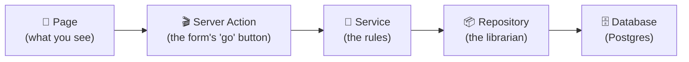
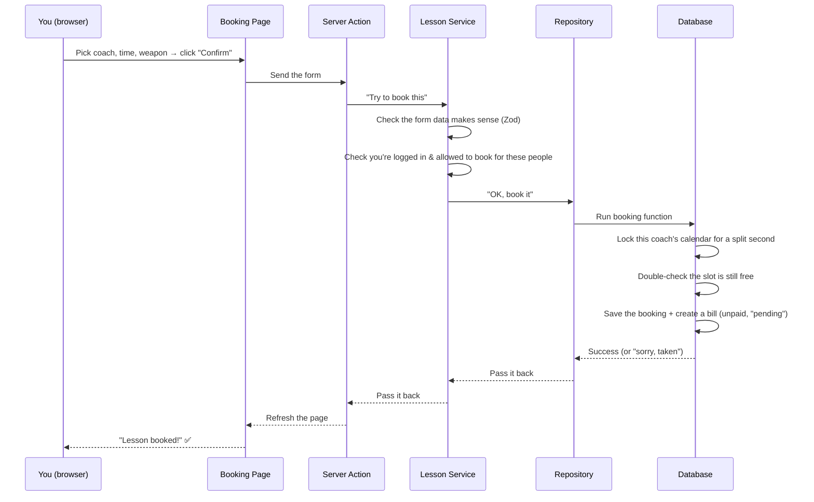

# Lesson Booking — Architecture Cheat Sheet

*A plain-English guide for Friday's demo day. If a panel member asks "how does X work," this is where the answer lives.*

---

## 1. The 30-second answer: how is this app built?

Every action in this app follows the same four-step relay race. Nothing ever skips a step.



Think of it like ordering food at a restaurant:
- **Page** = the menu you look at
- **Server Action** = telling the waiter what you want
- **Service** = the waiter checking "are you even allowed to order this? are you 18 for that beer?"
- **Repository** = the waiter walking to the kitchen and handing over the order slip
- **Database** = the kitchen, which actually cooks the food

No page is ever allowed to walk straight into the kitchen. It always goes through the waiter (Service) and the order slip (Repository). This keeps the code organized and stops any one part from doing too much.

### Where the lesson booking pages actually live

| What you see | Web address | File in the code |
|---|---|---|
| List of coaches | `/protected/book` | `app/protected/book/page.tsx` |
| Pick a time with one coach | `/protected/book/[coachId]` | `app/protected/book/[coachId]/page.tsx` |
| "My lessons" (member view) | `/protected/lessons` | `app/protected/lessons/page.tsx` |
| Coach's own schedule | `/protected/coach` | `app/protected/coach/page.tsx` |
| Coach sets their weekly hours | `/protected/coach/availability` | `app/protected/coach/availability/page.tsx` |
| Admin: manage coaches | `/protected/admin/coaches` | `app/protected/admin/coaches/page.tsx` |
| Admin: see every booking | `/protected/admin/lessons` | `app/protected/admin/lessons/page.tsx` |
| Admin: pricing & rules | `/protected/admin/lesson-settings` | `app/protected/admin/lesson-settings/page.tsx` |

---

## 2. "Walk me through what happens when I book a lesson"

This is the question most likely to come up. Here's the full journey, from click to confirmation.



**In plain words:** you fill in a form, the app checks the form isn't garbage, checks you're actually allowed to do this, then asks the database to lock that coach's calendar for a fraction of a second, double-check nobody just grabbed the same slot, and save the booking. Then it unlocks and shows you "booked!"

### Why the "lock" step matters — the double-booking problem

Imagine two people click "book the 3pm slot with Coach Alex" at the exact same millisecond. Without protection, both requests could see "3pm is free" at the same time and both succeed — now Coach Alex has two lessons booked at once. Oops.

The fix: the database briefly puts a **lock** on that coach's calendar (like a single bathroom key — only one person can hold it at a time), re-checks the slot is still free *while holding the key*, and only then saves the booking. The second person's request has to wait its turn, sees the slot is now taken, and gets a friendly "that slot was just taken, please pick another" message instead of a broken double-booking.

This is a genuinely solid, non-trivial piece of engineering — worth calling out if asked "how do you handle two people booking at once?"

---

## 3. Where does the "smart" logic live — the app, or the database?

Both, on purpose, doing different jobs:

| Layer | Job | Jargon-free version |
|---|---|---|
| **Zod** (validation) | Checks the shape of the data | "Is this actually a date? Is this actually an email?" — a bouncer checking your ID has the right *format*, not whether you're on the list |
| **Service** (`lib/services/`) | Checks *who* is asking | "Are you logged in? Are you allowed to do this?" |
| **Repository** (`lib/repositories/`) | Passes the request to the database | Just a messenger — no thinking, only delivering |
| **Database function** (Postgres) | The actual business rules | "Is this time slot available? Does the coach teach this weapon? What's the cancellation fee?" |

The heavy rules (is this coach free, what's the cancellation fee, is this a no-show) live **inside the database itself**, as a saved recipe called a **function** — think of it as a pre-written script the database runs when asked, so the rule can never accidentally be skipped no matter which part of the app calls it.

Key database functions, in plain English:

- `lesson_time_is_available` — "is this exact time slot actually free for this coach?"
- `create_lesson_booking_v2` — the whole booking process (lock → check → save → bill), described above
- `cancel_lesson_booking_v2` — cancels a lesson and works out if a late-cancellation fee applies
- `record_lesson_outcome` — coach marks a lesson as "attended" or "no-show," which turns a *pending* charge into a *real, billable* one

---

## 4. "Where are your Zod validations?"

Point straight at **`lib/validations/`**. Two files matter here:

- `lib/validations/member.schema.ts` — profile/member form rules
- `lib/validations/lesson.schema.ts` — everything booking-related

The one worth having memorized:

```ts
export const createLessonBookingSchema = z.object({
  coachId: z.uuid(),
  startsAt: z.iso.datetime({ offset: true }),
  participantIds: participantIdsSchema,   // must be 1 or 2 people, not the same person twice
  weapon: z.enum(['foil', 'epee', 'sabre']),
}).strict()
```

**Why it's "first and foremost":** it's called right at the top of the Service function, before anything else happens — before checking who you are, before touching the database:

```
Server Action (app/actions/lessons.ts)
   → LessonBookingService.createLessonBooking(raw)
        → createLessonBookingSchema.safeParse(raw)   ← the very first line of logic
        → only if that passes, do we check who you are, then hit the database
```

`.strict()` means any extra, unexpected fields get rejected outright too — not just wrong types.

---

## 5. "What stops a member from seeing someone else's private data?"

This is the security question, and the honest answer has two layers — but only one of them is the one that actually matters.

**Layer 1 — the app double-checks who's asking** (`lib/services/`). Example: before showing admin data, the code checks `profile.is_staff && profile.staff_type === 'admin'`. This is nice because it gives a friendly error message. But it's just a convenience — a bug in the app *could* accidentally skip this check.

**Layer 2 — the database itself refuses to hand over rows it shouldn't** ("Row-Level Security," or **RLS**). This is the real lock on the door. Even if the app had a bug, or someone wrote a raw database query by hand, Postgres itself checks "does this logged-in person actually own this row?" before returning *any* data — every single time, no exceptions.

**Think of it like a hotel:** the front-desk clerk asking "can I see your key card?" is Layer 1. But even if the clerk gets distracted, your hotel room door *itself* won't open without the right key card. That's RLS. It's the layer that actually can't be talked around.

A few real examples of RLS rules in this app:
- Billing info (charges, invoices) can only be seen by the person paying for it (or an admin) — **never** the dependent/fencer themselves, because kids shouldn't necessarily see the family's money details.
- A coach can see *that* a lesson is booked, but **cannot** see the price — pricing is deliberately hidden from coach accounts at the database level.
- A coach can only edit their *own* weekly availability, never another coach's.

### The three ways the app talks to the database

| File | Runs where | Can see everything, or only "your" rows? |
|---|---|---|
| `lib/supabase/server.ts` | On the server, per page/action | Only your rows (RLS applies) |
| `lib/supabase/client.ts` | In your browser | Only your rows (RLS applies) |
| `lib/supabase/admin.ts` | Server only, rarely used | **Everything** — bypasses RLS entirely, used only for things like sending invite emails. Never used for normal browsing. |

---

## 6. What is SQL, actually, and where does it live?

**SQL** is just the language a database understands — instead of writing "get me all the coaches" in TypeScript, you write it as SQL:

```sql
select * from coach_lesson_profiles where is_active = true;
```

The database functions mentioned in §3 (`create_lesson_booking_v2` and friends) are written in a slightly extended version of SQL called **PL/pgSQL** — basically SQL with a few programming bits bolted on (`if`, variables, loops), so the database itself can make small decisions, not just fetch and store rows.

**Where it's stored — two places, and it's important to know the difference:**

1. **As source code, in your repo** — every table, function, and security rule is written out in `supabase/migrations/`, as a series of numbered `.sql` files (`0001_profiles.sql` through `0011_lesson_booking_demo.sql`). This is the *human-authored, version-controlled recipe* — reviewable on GitHub exactly like any other code change.
2. **As live objects, inside the actual database** — once a migration file is run (`supabase db reset`, or pushed to production), its contents become real things sitting inside Postgres: a real table, a real function, a real security policy. The `.sql` file is the recipe; the running database is the meal that got cooked from it.

**Is it one giant file, or split up?** It's split by feature area, across dated files — not one dumping-ground file, and not scattered randomly either:

```
supabase/migrations/
  0001_profiles.sql                          — original members table
  0003_cfa_platform_foundation.sql           — core rules (admin checks, households)
  0005_account_membership_family_booking.sql — memberships, family links, old booking system
  0011_lesson_booking_demo.sql               — the WHOLE lesson booking system, ~840 lines
```

Almost every lesson-booking function lives together in that one file, `0011_lesson_booking_demo.sql`, because the whole feature was built as one self-contained unit:

| Function | What it does |
|---|---|
| `lesson_time_is_available` | is this exact slot free? |
| `list_available_lesson_times` | generate the list of bookable times |
| `get_lesson_quote` | work out the price |
| `create_lesson_booking_v2` | the whole booking process (lock + check + save) |
| `cancel_lesson_booking_v2` | cancel + work out any late fee |
| `reschedule_lesson_booking_v2` | move a booking |
| `record_lesson_outcome` | coach marks attended/no-show |
| `list_my_lesson_bookings` | "my lessons" list, with pricing stripped out |
| `list_coach_lesson_agenda` | coach's own schedule |
| `run_monthly_invoices` | turns charges into a real invoice |
| `admin_*` (5 functions) | admin-only actions — set up a coach, block dates, waive a charge |

One subtlety worth knowing: **inside the database itself, there are no folders.** Postgres just holds one flat list of functions. The "split into files" organization is purely how the code is arranged in the repo — once it's applied, Supabase doesn't remember or care which file a function originally came from.

---

## 7. A quick tour of the Supabase dashboard

If asked to "go to the database and show the source," this is what they mean — not the code editor, the actual live database, viewed through Supabase's built-in dashboard (hosted at app.supabase.com, or locally at `http://localhost:54323` while `supabase start` is running).

| Tab | What you'll find there | Say this |
|---|---|---|
| **Table Editor** | Every table as a spreadsheet — rows you can scroll through | "Here's `bookings`, you can see the seeded lesson we made earlier" |
| **Database → Functions** | Every function listed as a real, callable object, with its actual SQL | "Here's `create_lesson_booking_v2` — same code as in our migration file, now live" |
| **Database → Policies** | Every RLS rule, per table, in a readable list | "This is the rule that stops a dependent seeing billing data" |
| **Authentication → Users** | Every real login account (the seeded demo users) | "Here's `guardian@cfa.test`, the account I'm demoing with" |
| **SQL Editor** | A free-text box to run any SQL query directly | Good for "show me live" moments — e.g. `select * from bookings order by created_at desc limit 5;` |

**The one-line answer that shows you understand both halves:** *"The function's source is written in our migration file in the codebase — version-controlled, reviewable, like any other code — and once applied, it's a live object in Supabase, viewable under Database → Functions."*

---

## 8. "Where's the OOP / good software design in this?" (the rubric question)

The codebase is TypeScript, not classic Java/C#-style OOP, but the same *ideas* are all there:

- **Encapsulation** — only files inside `lib/repositories/` are allowed to talk to the database directly. Everything else has to go through them. It's a locked door with one key.
- **Interfaces (contracts)** — `types/domain.ts` defines exactly what a "Profile" or a "LessonBooking" looks like, and every layer of the app agrees to use that same shape. Like a shipping label format everyone in the warehouse uses.
- **Composition** — bigger functions are built out of smaller ones stuck together, rather than one giant function doing everything. E.g. "get my account info" = combine "get my household," + "get who pays," + "get my family members."
- **Inheritance / extension** — `AdminProfileUpdate` is a normal profile update *plus a few extra admin-only fields*. It reuses the base shape instead of copy-pasting it.
- **Polymorphism** — functions return either "here's your data" or "here's an error," and the calling code checks which one it got before acting. Same function shape, different result depending on what happened — that's the general idea of polymorphism (many forms, one interface).

---

## 9. General project architecture (not lesson-specific)

**How login works:** you type your email/password → Supabase (the login service) checks it → if correct, it hands your browser a little **cookie** (a small saved note, kept private, that says "this browser is logged in as X"). Every time you visit a page, a background helper called **middleware** quietly checks that cookie is still valid before letting you in — like a bouncer re-checking your wristband every time you walk through a different door of the club, not just at the front entrance.

**The stack, and why:**
- **Next.js** — the web framework. Lets pages run partly on the server (fast, secure) and partly in your browser (interactive).
- **Supabase** — a hosted Postgres database + login system + security rules, all bundled together, so we don't have to build our own login system from scratch.
- **Zod** — the "is this data shaped correctly" checker, used everywhere a form gets submitted.
- **Tailwind / shadcn** — the styling toolkit, so buttons/forms look consistent without hand-writing CSS for every single one.
- **Vitest** — automated tests, so a change to one part of the app doesn't quietly break another part without anyone noticing.
- **Vercel** — where the website actually lives online (hosting).

**Testing, in one line:** there are tests for the business rules (services), tests for the form-checking rules (Zod schemas), and tests that check the database setup itself hasn't been accidentally broken.

**Deployment, in one line:** every change gets automatically linted, tested, and built by a robot (GitHub Actions) before it's allowed near the live site, then the live site itself runs on Vercel with the database hosted by Supabase.

---

## 10. A tour of the project's files and folders

Every repo has an "actual app" pile and a "toolbox" pile around it. The app is `app/`, `components/`, `lib/`, `types/`, `supabase/` — everything covered elsewhere in this doc. Here's the toolbox: the root-level files that tell various tools how to treat that app.

**JSON vs JSONC, quickly:** JSON is a plain data format — `{ "key": "value" }`, no comments allowed. JSONC is "JSON with Comments," same thing but you can write `// notes` inside it. Everything in this repo is plain `.json`.

| File | Plain-English job |
|---|---|
| `package.json` | The project's ID card — its name, every library it depends on (Next.js, Zod, Tailwind...), and the **scripts** (shortcut commands, see below). |
| `package-lock.json` | The *exact* receipt of every dependency version actually installed, down to dependencies-of-dependencies. `package.json` might allow "any 4.x," this file pins "4.4.3, precisely" — so everyone on the team, and the CI robot, installs the identical thing. Nobody hand-edits this; npm writes it. |
| `next.config.ts` | Settings for Next.js itself. Currently empty (`{}`) — "just use the sensible defaults." |
| `next-env.d.ts` | Auto-generated by Next.js so TypeScript understands Next-specific things. Says "do not edit" at the top — it rewrites itself. |
| `tsconfig.json` | The rulebook for TypeScript. Turns on `"strict": true` (catch more mistakes before running the code) and the `@/` shortcut (`@/lib/utils` instead of counting `../../../`). |
| `eslint.config.mjs` | The style/quality checker ("linter") — catches things like unused variables before they become bugs. What `npm run lint` runs. |
| `tailwind.config.ts` | Settings for Tailwind CSS — custom colors, spacing, used site-wide. |
| `postcss.config.mjs` | Small plumbing step that plugs Tailwind into the build, plus `autoprefixer`, which quietly adds browser-specific CSS so styles work on Safari/Firefox without writing them by hand. |
| `components.json` | Config for **shadcn/ui**, the tool that generates the pre-built buttons/forms in `components/ui/` — tells it where to put things and how to style them. |
| `vitest.config.ts` | Settings for the test runner. What `npm test` uses. |
| `proxy.ts` | Not a config file — actual code. Next.js **middleware**: runs before every page request, checking your login cookie is still valid. See §9. |

### `package.json`'s **scripts** — the shortcut commands

| Command | What actually happens |
|---|---|
| `npm run dev` | Starts the site locally, live-reloading as you edit. Daily driver. |
| `npm run build` | Builds the real, optimized production version — also the best way to catch type errors before pushing. |
| `npm start` | Runs that already-built production version locally — mostly for double-checking a build before shipping. |
| `npm run lint` | Checks code style/quality. Doesn't run the app. |
| `npm test` | Runs all automated tests (Vitest). |
| `npm run test:db-workflows` | Runs SQL-level tests directly against the database — checks the booking/membership logic *inside* Postgres, not just the app code. |
| `npm run dev:local` | A custom variant that runs `scripts/dev-local.mjs` instead of the plain dev server, for extra local setup. |

Each one is just a nickname for a longer terminal command — `"scripts"` in `package.json` is literally a lookup table of `"nickname": "actual command"`.

### `scripts/` folder — different thing, actual standalone programs

- `dev-local.mjs`, `seed-hosted-users.mjs` — JavaScript setup/seeding helpers.
- `generate_*.py` — Python scripts that generate project documentation (handbooks, QA plans, diagrams).
- `__pycache__/` — Python's auto-generated bytecode cache, left behind from running those `.py` files. Clutter, not something anyone wrote on purpose.

### `tmp/` — scratch space

Dev server logs, error logs, generated doc drafts. Not part of the actual app — just leftover output from running things locally.

### `types/` folder

One file, `types/domain.ts` — the shared "shape dictionary" for the whole app (what a `Profile` or `LessonBooking` looks like). Every layer agrees to use these exact shapes. Covered in §8.

### `node_modules` — the pile of borrowed code

Not visible in the file list (it's huge, and gitignored) — where every library from `package.json` actually gets downloaded to after `npm install`. "A module" just means a reusable chunk of someone else's code. `package-lock.json` is the precise record of what's in there.

### `docs/` folder

Team-facing markdown docs — QA plans and specs — separate from this local demo-prep pair of files.

---

## 11. Why we built it this way — architectural decisions, justified

If asked "why did you do it like that," these are honest, defensible one-liners:

**Why Supabase instead of building your own backend?**
It bundles a real Postgres database, login/auth, and security rules into one product — for a student project on a tight timeline, that's weeks of boilerplate (password hashing, session handling, email confirmation) we didn't have to write ourselves, without giving up a "real" database underneath.

**Why put business rules inside the database (SQL functions) instead of just in the app code?**
Because rules like "never double-book a coach" have to hold true no matter *what* touches the data — the member-facing app today, an admin tool tomorrow, or a future feature nobody's written yet. The database is the one place every path is forced through, so it's the one place a rule can be guaranteed, not just hoped for.

**Why the layered structure (page → service → repository) instead of querying the database straight from the page?**
Each layer does one job. It means the business rules can be tested on their own, without needing a live database running. It also means if we ever changed database providers, only the repository layer would need to change — everything above it stays the same.

**Why validate on the server (Zod), not just in the browser form?**
A browser can be tampered with — dev tools, a script that skips the form entirely and calls the server directly. The server-side check is the one that can't be bypassed, so that's the one that actually matters; the client-side version is just there for a snappier user experience.

**Why both a service-layer check *and* RLS — isn't that double work?**
Belt and braces, deliberately. The service check gives a fast, friendly error message and avoids a wasted database round-trip when the answer is obviously "no." RLS is what actually *guarantees* safety, since it runs inside the database no matter which code path got there.

**Why migration files instead of just clicking around in the Supabase UI to build tables?**
Migrations are version-controlled, reviewable in a pull request, and repeatable — anyone on the team (or a brand-new laptop) can rebuild the exact same database from scratch by replaying the files in order. Clicking through a UI leaves no history and can't be code-reviewed by teammates.

**Why TypeScript in strict mode instead of plain JavaScript?**
With four people touching the same codebase, strict typing catches whole categories of mistakes (wrong field name, wrong type passed to a function) before the code even runs, rather than discovering them as a bug in production.

**Why run Supabase locally, in Docker, for the demo instead of the hosted cloud project?**
Local means the app talks to `localhost` instead of over the internet, so venue wifi dropping can't break the demo. It also means you can wipe and reseed to a guaranteed-clean state in seconds right before presenting, and nobody else (a teammate testing something) can touch your data mid-demo. See the Demo Day Runbook for the full breakdown. The Next.js app itself doesn't need containerizing — it deploys straight to Vercel in production, so that's not what's being tested for reliability here.

---

## 12. Honest caveats — get ahead of the "gotcha" questions

Being upfront about these makes you look *more* credible, not less:

- **No real payment gateway yet.** Invoices are sent, but payment is currently a manual bank transfer — this is a deliberate scope decision for this stage, not a bug. The setting is even locked in the database as `payment_mode = 'invoice_only'` on purpose.
- **Coach photos are hand-picked stock photos**, matched to the coach's name for the demo. Everything else about the coach (their real weekly hours, which weapons they teach) is genuinely live data, not fake.
- **There's an older "v1" booking system still sitting in the database** alongside the new one, kept for compatibility. Only the new one is used in this demo. Mention this only if someone asks why the database has some booking-related leftovers.
- **One naming detail changed over time:** early on, users had a single "role" (admin/coach/fencer/guardian). As the team understood the domain better, this was split into two more accurate ideas — "is this person staff (and what kind)?" and "is this person the one paying, or a dependent?" — because in real life a person's *job* (coach) and their *billing relationship* (who pays for them) are two separate things. A good, honest example of the design evolving as the team learned more.

---

## 13. Quick-fire Q&A

**Q: How do you stop two people booking the same slot at once?**
A: The database briefly locks that coach's calendar, re-checks availability while holding the lock, and only then saves — so the second request always sees "already taken" instead of creating a conflict. See §2.

**Q: Where does validation happen — in the browser, or on the server?**
A: Both, but the server-side check (Zod, inside the Service) is the one that actually matters — the browser-side check is just for a nicer, faster user experience. See §4.

**Q: Can a coach see how much a lesson costs?**
A: No — pricing is deliberately hidden from coach accounts, enforced at the database level, not just hidden in the UI.

**Q: What happens if I'm logged in as a kid (dependent) — can I see the family's bill?**
A: No. Billing is visible only to the paying household member (or an admin) — the database itself refuses to return that data to anyone else.

**Q: Is this hosted, or just running locally?**
A: Built to run on Vercel (website) + Supabase (database), both cloud-hosted; local dev is just for building/testing before it ships.

**Q: What's the database actually doing vs. the app code?**
A: The app checks "who are you, are you allowed" — the database itself holds the real business rules (availability, fees, no-show handling) as saved functions, so those rules can never be bypassed. See §3 and §6.

**Q: Why do some names in the code (e.g. "role") not match what I see in the docs?**
A: The design evolved — see §12. A good sign of active, thoughtful iteration rather than a mistake.

**Q: Is this feature a mockup for the demo, or does it actually work?**
A: It's genuinely functional — real availability calculation, real conflict prevention, real security rules. Only the coach photos and a handful of seeded test accounts are demo dressing, not the booking logic itself.

**Q: Do you use Docker?**
A: Yes — for the demo, Supabase runs locally as Docker containers (Postgres, Auth, the dashboard), which we chose specifically so the demo doesn't depend on venue wifi and can be reset to clean data in seconds beforehand. The Next.js app itself isn't containerized, since it deploys directly to Vercel in production.
