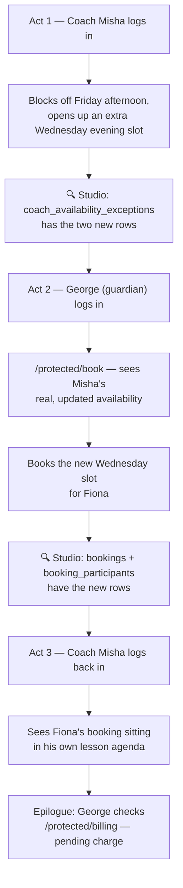

# Demo Day Runbook — Lesson Booking

*Your script for Friday. Follow top to bottom. Keep `DEMO-ARCHITECTURE-QA.md` open in another tab for Q&A.*

---

## Before Friday — do this the night before, not the morning of

1. Start everything and reset the data, so the demo starts from a known, clean state:
   ```bash
   npx supabase start      # boots local Postgres/Auth/Studio in Docker (skip if already running)
   npx supabase db reset   # wipes and reseeds the local database
   npm run dev:local        # starts the website, auto-wired to local Supabase — no .env.local needed
   ```
   Use `dev:local`, not plain `dev` — `dev` expects a hand-written `.env.local` with real hosted-project credentials, which you don't want for a demo. `dev:local` auto-detects the local Supabase instance every time it starts, so there's nothing to configure or get stale.

   **If you ever do need the raw local values** (e.g. a script that isn't `dev:local`), get them from `npx supabase status` — see `TEAM-SETUP-TROUBLESHOOTING.md` §4 for the full `.env.local` reference. They're stable, non-secret, local-only values, not anything to guard.

   **Run Supabase locally (in Docker), not the hosted cloud project.** `supabase start` spins up Postgres/Auth/Studio as Docker containers on your own laptop — that's the default, you get it for free. This is the right choice for a live demo, not just the convenient one:
   - **No wifi dependency.** Your app talks to `localhost`, not the internet — venue wifi dropping or lagging can't touch you.
   - **Instant, guaranteed-clean state.** `supabase db reset` right before you go on gets you back to the exact known-good seed data in seconds.
   - **Nobody else can touch it mid-demo.** It's fully yours — no risk of a teammate's test data showing up live because they hit the shared cloud dev project.
   - **It's the environment you already test in every day** — not something new and unpracticed.

   The only prep this needs: make sure Docker Desktop is installed and has already been run at least once (`supabase start`) **on the exact laptop you'll present from**, since the very first start pulls container images and can be slow — every start after that is quick.

   The Next.js app itself just runs via `npm run dev` on top of that — no need to containerize the app itself, since it isn't what's being tested for reliability here.
2. **Do one full dry-run** of the entire click-path below, start to finish, out loud, like you're actually presenting. This catches surprises while you still have time to fix them.
3. Write down (or screenshot) these login details so you're not hunting for them live:

| Who | Email | Password | Use this account for... |
|---|---|---|---|
| Guardian / payer | `guardian@cfa.test` | `Test1234!` | Booking a lesson, viewing billing |
| Coach | `coach@cfa.test` | `Test1234!` | Showing the coach's-eye view |
| Admin | `admin@cfa.test` | `Test1234!` | Showing the admin console |

4. Have a **backup**: a couple of screenshots (or a short screen recording) of the flow working, saved somewhere easy to grab, in case Wi-Fi or the live app misbehaves mid-demo.
5. **If login gives `Failed to fetch` in the browser console**, that's a known Windows + Docker Desktop issue, not your code: run `npx supabase status` — if it lists Auth/Kong as stopped services and only the database is up, run `npx supabase stop` then `npx supabase start` again. Full explanation and permanent fix in `TEAM-SETUP-TROUBLESHOOTING.md` §5.
6. **If login still fails after that**, check that `npm run dev:local` is actually still running in a terminal window — it's easy to lose track of and it doesn't restart itself if a terminal gets closed or the laptop sleeps.
7. **If you're rehearsing this more than once without a `supabase db reset` in between**, three things behave correctly but can look like bugs if you don't expect them:
   - **Adding the exact same weekly recurring range twice** fails with a vague "could not be completed" message — it's a duplicate, not a broken form. Vary the day/time on a second rehearsal, or reset first.
   - **Picking "right now" or a time more than 28 days out** shows zero available slots — that's the booking window (2 hours minimum notice, 4 weeks ahead max) working as designed, not empty data.
   - **Blocking a time range that already has a booking in it** (left over from an earlier un-reset rehearsal) gets rejected unless you tick "Confirm affected cancellations" — the system is protecting a paying family from a silent cancellation.
   - The simplest fix for all three, any time you're about to rehearse: `npx supabase db reset` first, every time.

---

## The demo, step by step (~8–10 minutes) — told as a story

The strongest version of this demo isn't "here's a booking form" — it's a **closed loop**: a coach changes his week, a parent finds and books the exact thing he just changed, and the coach watches it land back on his own screen. That loop is what actually proves the system is real and live, not three disconnected screenshots.

Three characters, three real seeded accounts — no invented names, these all exist in the seed data:

| Character | Account | Their part in the story |
|---|---|---|
| **Coach Misha** (Dr. Misha Galukhin) | `coach@cfa.test` | Opens the story — shapes his own week |
| **George** (George Guardian) | `guardian@cfa.test` | The parent — finds the new slot, books it for his daughter |
| **Fiona** (Fiona Fencer) | *no login — she's a junior* | The fencer actually taking the lesson, picked by George at booking time |



### Act 1 — Coach Misha shapes his week
Log in as `coach@cfa.test`. Land on `/protected/coach` — his lesson agenda. Point out the **"Manage my availability"** button, click it → `/protected/coach/availability`.

Narrate: *"Misha normally coaches épée Tuesdays and Thursdays. This week two things changed: he's got team photos Friday afternoon, and he just picked up a free Wednesday evening he wants to open up."*

1. **Block a slot.** Under **Add exception** → Change type: **Block availability**. Set Friday afternoon, optionally type a reason ("Team photos") in the **Reason** field, hit **Add exception**.
   - Worth a beat here: there's also a **"Preview affected lessons"** button above the form — it shows you any already-booked lessons a block would collide with, *before* you confirm, so you never silently strand a paying family. Good line: *"It won't let me quietly cancel someone's paid lesson by accident."*
2. **Add a slot.** Same panel, Change type: **Add extra hours**. Set Wednesday evening, hit **Add exception**.

Say: *"Notice this form never mentions who might book either of these — Misha can only ever touch his own calendar. That's not a UI choice, it's a database rule; he's physically not allowed to query anyone else's schedule."*

**🔍 Prove it — check the database.** Open a second tab to Supabase Studio (`http://localhost:15423`) → **Table Editor** → `coach_availability_exceptions`. Two new rows sitting there: one `block` (Friday), one `extra` (Wednesday), both stamped with Misha's `coach_id`. Say: *"This isn't app state — it's a real table, and I just watched two rows land in it."*

### Act 2 — George finds the slot and books it
Log out, log back in as `guardian@cfa.test` — this is George, Fiona's dad. Go to `/protected/book`, the coach directory.

Say: *"This list is genuinely live — not a cached snapshot from this morning."* Click into Misha's card → `/protected/book/[coachId]`. Point out: Friday afternoon is gone from the available times, and the new Wednesday evening slot — the one Misha opened up ninety seconds ago — is sitting right there.

Pick that Wednesday slot. Under **"Choose one or two fencers,"** tick **Fiona Fencer** — not George himself, since he's booking on his daughter's behalf. Pick a weapon, hit **Confirm**.

**If you get "that slot was just taken"** — don't panic, that's actually a great moment. It means the double-booking protection is working (see the cheat sheet, §2). Pick a different time, keep going, and say out loud that this is the safety system catching a conflict, not a bug.

Head to **"My Lessons"** (`/protected/lessons`) and point out the new booking sitting there, Fiona's name attached.

**🔍 Prove it — check the database.** Back in Studio → **Table Editor** → `bookings`, newest row at the top: Misha's `coach_id`, the exact Wednesday evening `starts_at` he opened in Act 1. Open `booking_participants` next to it — one row linking that booking to Fiona. Say: *"Same database, same tables Misha's changes landed in two minutes ago — this is the closed loop, not two separate demos."*

### Act 3 — Back to Misha: the booking lands
Log out, log back in as `coach@cfa.test`. Land on `/protected/coach` again — his lesson agenda now shows the new booking: Fiona Fencer, Wednesday evening, the exact slot he opened two minutes ago in Act 1.

Say: *"I'm not refreshing a demo — I'm looking at the same database row from the other side."* Good moment to also mention: Misha can see **that** the lesson is booked and **who's** attending, but never **what it costs** — pricing is blocked from coaches at the database level, not just hidden in the UI.

### Epilogue — the money side
Back as George (`guardian@cfa.test`), open `/protected/billing`. Point out the new lesson shows as a **pending** charge — it only becomes a real, payable invoice once the lesson happens (or is cancelled late). Payment right now is a manual bank transfer by design — a deliberate scope decision, not a missing feature.

### Wrap up
Close with the one-paragraph architecture summary: *"Every single action in that story — Misha blocking a slot, George booking it, Misha seeing it — went through the same four steps: page, action, service, database. And the real rules — who can touch whose calendar, what a coach can and can't see — live inside the database itself, so they can't be accidentally bypassed from the app side."* Offer to answer questions — that's your cue to lean on the cheat sheet doc.

**Optional, if there's extra time:** log in as `admin@cfa.test` and show `/protected/admin/lessons` — the full list of every booking across the club, with the ability to cancel or fix mistakes. Good for showing this isn't just a member-facing happy path.

---

## What to call out, and why (mapping to what's actually being graded)

| Demo moment | What it demonstrates |
|---|---|
| Misha blocking/adding availability, and George immediately seeing it | Genuinely live, two-sided system — not a static mockup |
| "Preview affected lessons" before a block is confirmed | Thought-through business logic protecting real users, not just CRUD |
| Coach can only edit his own calendar | Real security (RLS) enforced at the database level, not the UI |
| Booking + the "slot taken" safety net | Solid engineering under the hood, not just a pretty screen |
| Coach can't see pricing | Real security enforced at the database level |
| Billing only visible to the payer | Privacy-by-design, thought through for families with kids |
| Admin console | A full, real feature — not just the member-facing happy path |
| The four-step architecture summary | Clean, organized code that's easy for teammates to work in |

---

## If something breaks live

1. Stay calm, narrate what *should* happen: *"Normally this would show available times pulled live from the coach's schedule."*
2. Fall back to your screenshots/recording from the night-before dry run.
3. Refresh the page once — most one-off glitches are just a stale page.
4. If the booking itself fails oddly, that's a legitimate opening to explain the safety mechanisms (locking, validation) rather than a dead end — turn it into a talking point.
5. Keep `DEMO-ARCHITECTURE-QA.md` open in a second tab the whole time, for anything you get asked that isn't covered by what's on screen.

---

## If they ask to see "the actual database"

They mean the **Supabase dashboard**, not your code editor. With `supabase start` running, it's at `http://localhost:15423`. Quick map so you're not fumbling live:

| Click here | To show |
|---|---|
| **Table Editor** | The raw data — e.g. open `bookings`, point at the row you just created |
| **Database → Functions** | The actual `create_lesson_booking_v2` function, live, same code as in the migration file |
| **Database → Policies** | The security rules (RLS) per table |
| **SQL Editor** | Run a live query on request, e.g. `select * from bookings order by created_at desc limit 5;` |

One-liner if pushed on where the "source" really is: *"It's written in our migration file in the codebase — reviewable like any other code — and once applied, it's a live object here in Supabase."*
