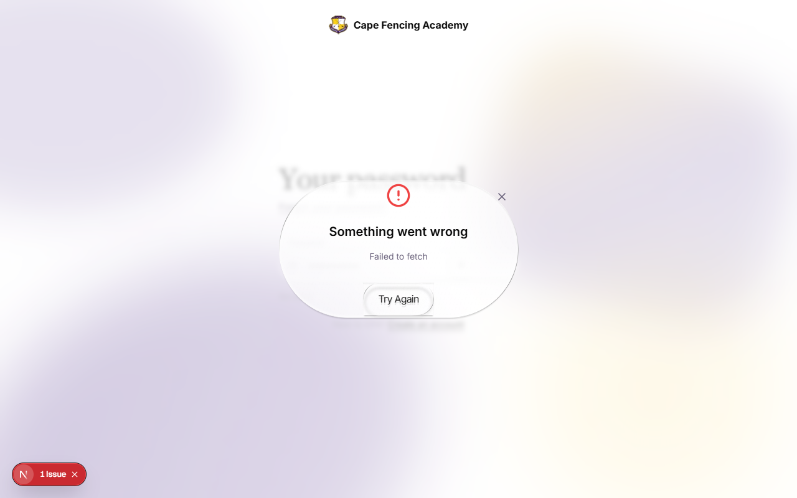

# BUG-001 - Login cannot reach configured Supabase host

| Field | Value |
|---|---|
| Priority | P0 |
| Status | open |
| Phase | 00 |
| Test ID | P0-B1 |
| Reported | 2026-07-23 |
| Tracker | Local Markdown only |

## Summary

Submitting valid seeded admin credentials leaves the user on the login
page with “Failed to fetch” because the browser cannot resolve the
configured Supabase Auth hostname.

## Impact

No user can enter the member portal or admin dashboard. All membership,
household, lesson, billing, and administration journeys are blocked.

## Actual

The login modal displays “Something went wrong” and “Failed to fetch.”
The page remains at `/auth/login`. Chromium records
`net::ERR_NAME_NOT_RESOLVED`, followed by a Supabase Auth JavaScript
`TypeError: Failed to fetch`.

## Expected

Valid admin credentials should create a Supabase session and redirect
the user to `/protected` without console or network errors.

## Risk to fix

Configuration-sensitive. Correcting the frontend Supabase URL should be
low risk, but the development server must be restarted so Next.js
rebuilds the public client configuration.

## Steps to reproduce

1. Confirm the CFA website responds at `http://localhost:3000`.
2. Confirm local Supabase Auth health responds with HTTP 200.
3. Open a fresh browser context at `http://localhost:3000/auth/login`.
4. Enter `admin@cfa.test` and continue to the password step.
5. Enter the seeded test password and click “Log in.”
6. Wait four seconds and observe the error modal and unchanged URL.

## Evidence

### Console

```text
Failed to load resource: net::ERR_NAME_NOT_RESOLVED
TypeError: Failed to fetch
at SupabaseAuthClient.signInWithPassword
at handleSubmit
```

### Environment

- `http://127.0.0.1:54321/auth/v1/health` returned HTTP 200.
- `http://localhost:3000` returned HTTP 200.
- A direct password grant against the local Auth API succeeded before
  the browser pass.
- Therefore the local backend and credentials are available; the
  browser-facing frontend address is the failing boundary.

### Screenshot



### URL at failure

`http://localhost:3000/auth/login`

## Notes

- Reproduced through real browser interaction, not source inspection.
- Do not read or publish real `.env` values. Compare the configured
  public Supabase URL against the local API URL using the user’s normal
  secret-management process.
- Once login works, verify the seeded admin has `is_staff=true` and
  `staff_type='admin'`; source discovery indicates a separate seed-model
  mismatch may block `/protected/admin`.

## Triage log

- 2026-07-23: Filed as P0. Auto QA stopped before protected workflows.
