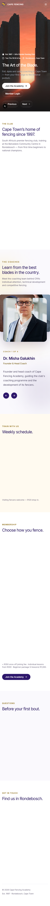

# BUG-002 - Public footers omit required links

| Field | Value |
|---|---|
| Priority | P1 |
| Status | open |
| Phase | 00 |
| Test ID | P0-A5 |
| Reported | 2026-07-23 |
| Tracker | Local Markdown only |

## Summary

The homepage footer omits Privacy/POPIA and Terms, while secondary-page
footers omit CFA contact and social information.

## Impact

Visitors cannot consistently reach the required legal, contact, and
social destinations from the page they are currently reading. Direct
URLs provide a workaround.

## Actual

The homepage footer contains location, email, Facebook copy, training
hours, and copyright, but no Privacy/POPIA or Terms links. Secondary
pages contain Privacy/POPIA and Terms links, but not the complete CFA
contact and social information.

## Expected

Every public page footer should provide contact information, social
links, Privacy/POPIA, and Terms.

## Risk to fix

Low. The two existing footer implementations need a shared, complete
destination set without changing the protected hero or login designs.

## Steps to reproduce

1. Open `http://localhost:3000/` at 375x812.
2. Scroll to the bottom of the homepage.
3. Observe that Privacy/POPIA and Terms are absent.
4. Open `http://localhost:3000/classes`.
5. Scroll to its footer.
6. Observe that the legal links appear, but CFA contact and social
   information is absent.

## Evidence

### Screenshot

### Browser result

- Both routes returned HTTP 200.
- Neither route had horizontal overflow.
- Visible footer text differed as described at mobile, tablet, and
  desktop widths.

## Notes

- Reproduced through the live browser at all three supported viewports.
- Suggested fix area: `components/landing/contact-footer.tsx` and
  `components/public-page-shell.tsx`.

## Triage log

- 2026-07-23: Filed as P1 with direct-route workaround.
