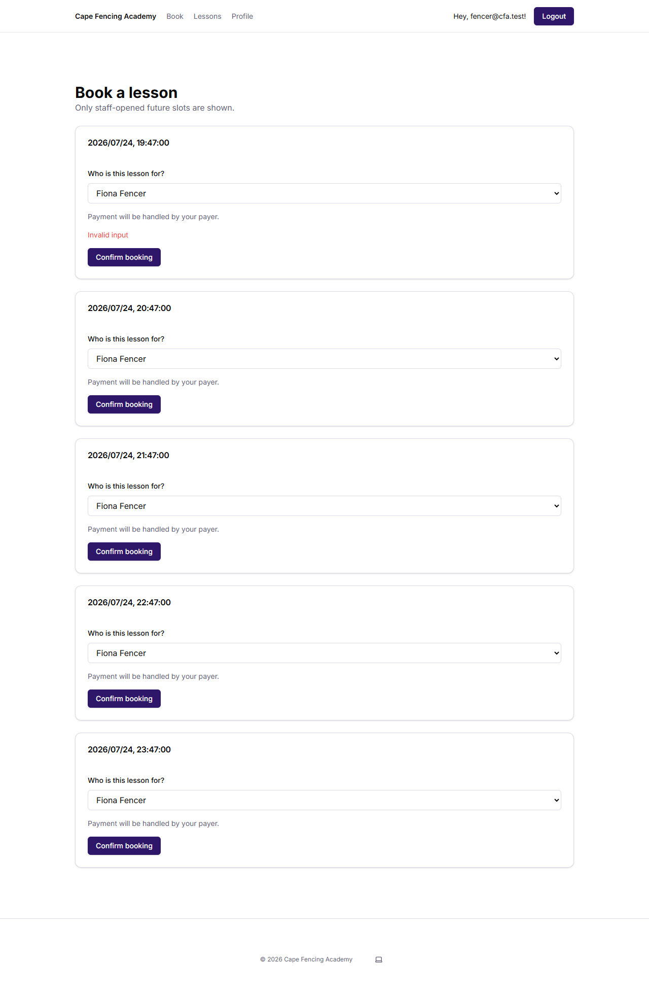

# BUG-003 - Seeded users cannot book lessons

| Field | Value |
|---|---|
| Priority | P1 |
| Status | open |
| Phase | 00 |
| Test ID | P0-D2, P0-D3, P0-D4 |
| Reported | 2026-07-23 |
| Tracker | Local Markdown only |

## Summary

Submitting a lesson booking for a seeded local test account returns
“Invalid input” and creates no booking.

## Impact

The guest, dependent, and payer booking journeys cannot be completed
with the documented local test accounts. Lesson-history and downstream
charge-attribution acceptance checks are blocked.

## Actual

The dependent booking form correctly limits Fiona Fencer to herself and
forces payer-managed payment. Clicking “Confirm booking” displays
“Invalid input.” The lesson history remains empty, and the database has
zero booking rows.

## Expected

The seeded account identifiers should pass the same request validation
as production Supabase Auth identifiers. A valid booking should create
one booking and one attributed charge.

## Risk to fix

Seed-sensitive. Changing seeded Auth identifiers requires updating every
related seeded profile, household, and identity reference consistently.

## Steps to reproduce

1. Reset and seed local Supabase.
2. Log in as `fencer@cfa.test` through the browser.
3. Have an admin approve the membership request, attach Fiona to the
   payer household, and open a future lesson slot.
4. Open `/protected/book`.
5. Click “Confirm booking.”
6. Observe “Invalid input,” then open `/protected/lessons`.

## Evidence

- Browser alert: `Invalid input`
- Lesson history: `No lessons yet.`
- Database after reproduction: five lesson slots and zero bookings.
- Source correlation: the booking schema uses strict `z.uuid()`, while
  the fixed seeded user IDs do not contain RFC-compliant version and
  variant bits.

## Triage log

- 2026-07-23: Filed as P1 after repeatable real-browser reproduction.
