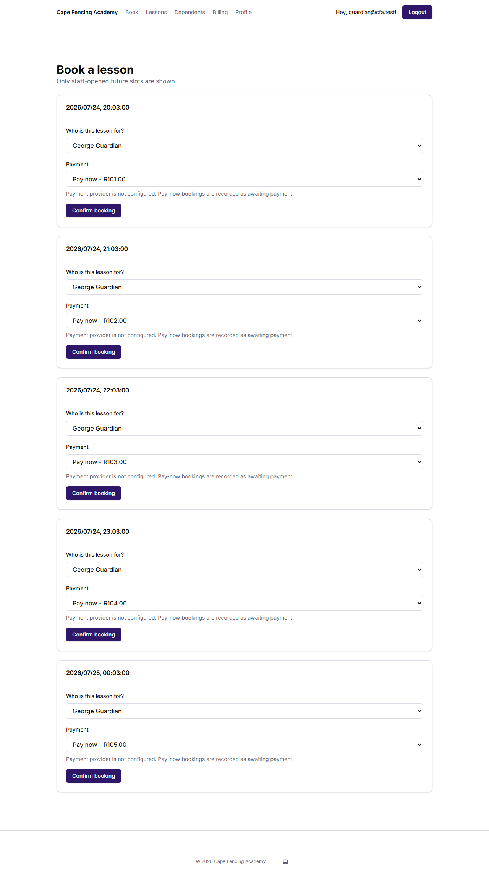

# BUG-004 - Payer cannot identify dependent when booking

| Field | Value |
|---|---|
| Priority | P1 |
| Status | resolved |
| Phase | 00 |
| Test ID | P0-D4 |
| Reported | 2026-07-23 |
| Tracker | Local Markdown only |

## Summary

After an admin attaches Fiona Fencer to George Guardian’s household, the
payer booking selector displays the dependent as “Account member”
instead of her name.

## Impact

A payer cannot reliably choose the intended fencer. Multiple dependents
would be indistinguishable, blocking safe payer-created bookings.

## Actual

The selector contains `George Guardian` and `Account member`. The
household row is visible, but the joined dependent profile is hidden by
profiles RLS.

## Expected

The adult payer should see the name of each member in their own
household. Dependents must still be unable to read payer or sibling
profile and financial data.

## Risk to fix

Authorization-sensitive. The policy must be restricted to an
authenticated payer and profiles in the exact same household. It must
not broaden dependent or cross-household reads.

## Steps to reproduce

1. Reset and seed local Supabase.
2. As admin, attach Fiona Fencer to George Guardian’s household.
3. Log in as `guardian@cfa.test`.
4. Open `/protected/book`.
5. Inspect “Who is this lesson for?”
6. Observe `Account member` instead of `Fiona Fencer`.

## Evidence

## Triage log

- 2026-07-23: Filed as P1 after focused real-browser reproduction.
- 2026-07-23: Resolved with a payer-only, same-household profile select
  policy backed by a non-recursive security-definer predicate.

## Verification

- George’s live booking selector now contains `George Guardian` and
  `Fiona Fencer`.
- George booked both himself and Fiona.
- A tampered booking for Alice Admin was rejected as cross-household.
- Fiona still had no billing navigation, received HTTP 404 for direct
  billing access, and saw no household financial details.
