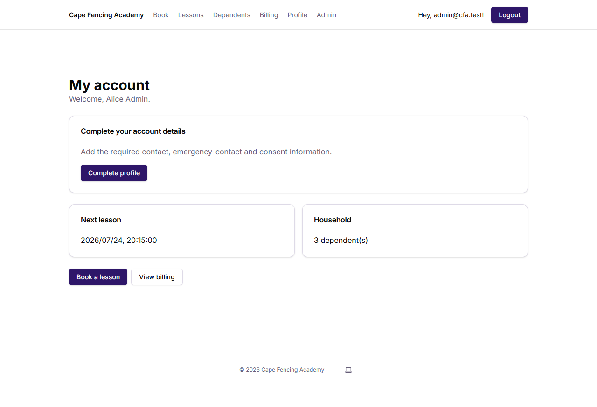

# BUG-005 - Admin personal dashboard counts all visible households

| Field | Value |
|---|---|
| Priority | P2 |
| Status | open |
| Phase | 00 |
| Test ID | Supplemental dashboard check |
| Reported | 2026-07-23 |
| Tracker | Local Markdown only |

## Summary

Alice Admin’s personal account dashboard reports three dependents and
shows a Dependents navigation entry even though Alice has a
household-of-one account.

## Impact

The personal household summary is misleading for administrators. Admin
workflows and the dedicated staff dashboard remain functional.

## Actual

`/protected` displays `Household - 3 dependent(s)`. The local database
shows Alice, Charles, and George as payers in separate households and
only Fiona as a dependent in George’s household.

## Expected

The personal dashboard should count only rows matching Alice’s own
household. Admin-wide member visibility should remain confined to staff
workflows.

## Risk to fix

Low to moderate. Personal household filtering must not remove the
admin’s separate ability to book for any active fencer.

## Steps to reproduce

1. Reset and seed local Supabase.
2. Log in as `admin@cfa.test`.
3. Open `/protected`.
4. Observe the Dependents navigation item and household count.

## Evidence

## Triage log

- 2026-07-23: Filed as P2. Non-blocking for Phase 00 sign-off.
